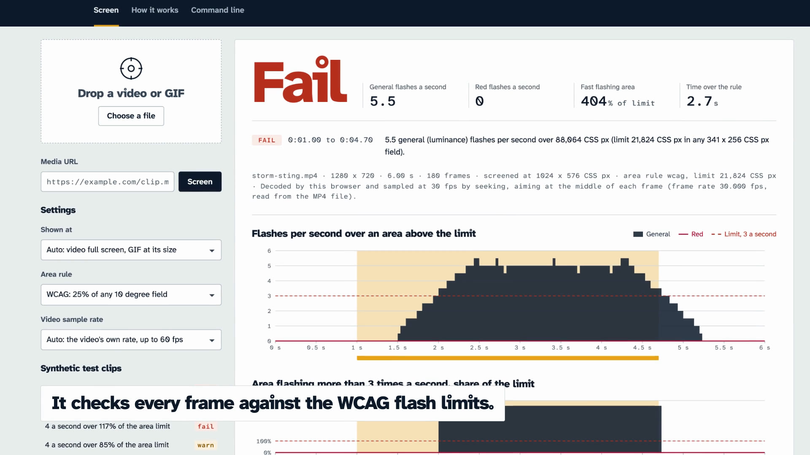
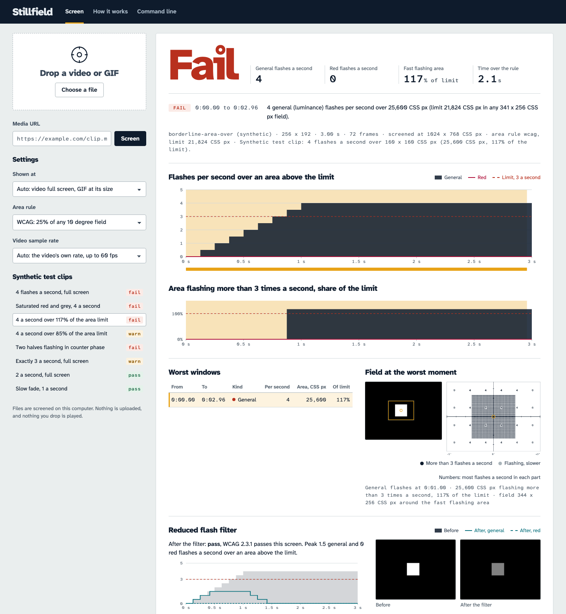

# Stillfield

[](https://github.com/draarivpatel-ui/stillfield/releases/download/v0.1.0/stillfield-launch-film-1920x1080.mp4)

[Watch the launch film](https://github.com/draarivpatel-ui/stillfield/releases/download/v0.1.0/stillfield-launch-film-1920x1080.mp4) (43 s, 1920 x 1080, MP4) · [Try it in your browser](https://aariv.me/stillfield/) · [Release v0.1.0](https://github.com/draarivpatel-ui/stillfield/releases/tag/v0.1.0)



## What it does

Stillfield screens videos, GIFs and web pages for flashing that can trigger seizures in people with photosensitive
epilepsy, against [WCAG 2.2 Success Criterion 2.3.1](https://www.w3.org/WAI/WCAG22/Understanding/three-flashes-or-below-threshold.html)
(general flash and red flash thresholds). It tells you when, how fast and how large the flashing is, can write a
reduced flash version of a failing clip and screen it again, and runs four ways:

- a command line tool for files, folders of frames and web pages;
- a GitHub Action that screens the media files a pull request changes;
- an MCP server, so a coding agent can screen the animations and videos it makes;
- [a web page](https://aariv.me/stillfield/) that screens a dropped video or GIF on your own computer. Nothing is
  uploaded, and the dropped file is never played: results are numbers, charts and still frames.

The name comes from that last rule. The page shows the field of view as stills and numbers and never replays the
flashing it found.

## Install

Node 22.18 or newer. Video needs `ffmpeg` and `ffprobe` 4.4 or newer on your PATH (or `FFMPEG_PATH` and
`FFPROBE_PATH`); GIFs and PNG frames do not. Web pages need `playwright-core` (an optional dependency) and its
Chromium build.

Stillfield is not on npm. Install it from a clone:

```sh
git clone https://github.com/draarivpatel-ui/stillfield.git
cd stillfield
npm install
node src/cli.ts clip.mp4               # Node runs the TypeScript sources directly
npm run build && npm link              # optional: a `stillfield` command from dist/
npx playwright-core install chromium   # only for screening web pages
```

The commands below write `stillfield` for either form.

## Use

```sh
stillfield clip.mp4                         # text report, exit 1 on a failure
stillfield intro.gif --json > report.json   # schema stillfield/report@1
stillfield frames/ --fps 60                 # a folder of PNG frames
stillfield https://example.com --duration 10
stillfield clip.mp4 --fix                   # writes clip.reduced.mp4 and screens the written file
stillfield media/*.mp4 --sarif stillfield.sarif
```

```text
clip.mp4: 256 x 192, 3.00 s, 72 frames at 24.00 fps
screened at 1024 x 768 CSS px; area rule "wcag": more than 21,824 CSS px flashing together in any 341 x 256 CSS px field (searched with a 344 x 256 window)
FAIL  WCAG 2.2 SC 2.3.1 screen: fails
  general flashes: up to 4 a second over an area above the limit; largest area flashing more than 3 times a second: 25,600 CSS px (117% of the limit)
  red flashes:     none over an area above the limit
  fail  0:00.00 to 0:02.96  4 general (luminance) flashes per second over 25,600 CSS px (limit 21,824 CSS px in any 341 x 256 CSS px field).
```

| Option | Meaning |
| --- | --- |
| `--display WxH` | Size the content is shown at, exactly W x H CSS px. Default: video full screen at the 1024 x 768 reference, GIFs and images at their own size, pages 1024 x 768. Also `native`, `fullscreen`. |
| `--area wcag` | 25% of any 341 x 256 CSS px field (default, the normative reading). `understanding`: 87,296 CSS px. `frame`: 25% of the frame (broadcast and IRIS). |
| `--fix`, `--fix-out` | Write a reduced flash version of a video or GIF, then decode and screen the written file. `--fix-out` takes one input and never the input itself (not by another spelling or link either). |
| `--json`, `--timeline`, `--out`, `--sarif` | Machine readable output. |
| `--fps`, `--duration`, `--settle` | Frame rate for PNG folders and pages; seconds to record a page and to let it settle. |
| `--no-loop`, `--background`, `--red-floor` | GIF looping (on by default), colour behind transparent GIF and PNG pixels, near black floor for the red test. |
| `--strict`, `-q`, `--no-color` | Exit 1 on warnings too; one line output; plain text. |

Exit codes: 0 no failure found, 1 a failure (or a warning with `--strict`), 2 could not run, or could not read the
whole file (truncated or damaged) and found no failure in the part it read. Reports carry `complete: false` and a
warning whenever part of the content was not screened.

### GitHub Action

```yaml
on: pull_request
jobs:
  flashing:
    runs-on: ubuntu-latest
    steps:
      - uses: actions/checkout@v4
        with: { fetch-depth: 2 }
      - uses: actions/setup-node@v4
        with: { node-version: 22 }
      - uses: draarivpatel-ui/stillfield@v0.1.0   # screens media files changed by the pull request
        with: { fail-on: fail }
```

Inputs: `paths` (files or globs; empty means changed media), `extensions`, `area`, `display`, `fail-on`, `sarif`.
It writes a job summary table, file annotations and a SARIF file, and sets `verdict`. The Action is tested with
simulated `GITHUB_*` variables (`test/action.test.ts`); it has not yet been run on GitHub's hosted runners.

### MCP server for coding agents

```json
{ "mcpServers": { "stillfield": { "command": "node", "args": ["/path/to/stillfield/src/mcp.ts"] } } }
```

One tool, `screen_media` (`path_or_url`, optional `area`, `display`, `duration` up to 120 s, `fps`), returns the
text report and the JSON report as structured content. Useful when an agent writes CSS animations, canvas effects or
videos.

### Web page

Use it at [aariv.me/stillfield](https://aariv.me/stillfield/), or run `npm run build:web` and serve `web/` from any
static host. Drop a video or GIF, or paste a media URL; it is decoded by seeking frame by frame and screened in a Web
Worker. Synthetic test clips are built in. A browser page cannot record other websites, so page URLs are pointed to
the command line.

### Library

```ts
import { FlashAnalyzer } from 'stillfield/core'; // no Node APIs: works in browsers and workers
const a = new FlashAnalyzer({ width, height, format: 'rgba', displayWidth: 1024, displayHeight: 768 });
for (const frame of frames) a.push(frame.data, frame.time);
const report = a.finish(); // verdict, wcag231, reasons, worstWindows, perSecond, timeline
```

## How it works

The rule and every choice behind it are in [SPEC.md](SPEC.md), with quotes from the primary sources.

1. Each frame is resampled to cells of 2 x 2 CSS px at the size it is shown, averaging in linear light (about 0.06
   degree, under the 0.1 degree fine pattern exception).
2. Each cell tracks relative luminance (WCAG formula) with a peak and valley tracker: a transition is a change of 0.1
   or more whose darker side is under 0.8. Each cell also tracks CIE 1976 u'v' chromaticity: a red transition is a
   move of more than 0.2 to or from a saturated red (R/(R+G+B) of 0.8 or more, linear). A flash is two transitions.
3. A cell with 7 or more transitions in a one second window (more than 3 flashes) is flashing too fast. On every
   frame a summed area table finds the 341 x 256 CSS px window holding the most such area. Over 21,824 CSS px fails.
4. Warnings, kept apart from the WCAG result: exactly 3 flashes a second, 80% to 100% of the area limit, and 2 or
   more flashes a second sustained for 4 s within 5 s (EA IRIS's "extended failure", ITU-R BT.1702's five second
   note).
5. `--fix` applies an adaptive temporal filter (BT.1702 Annex 4): where a cell has flashed in the last second, output
   follows a slow moving average of the input. The written file is decoded and screened again; the filter strengthens
   up to three times if it still fails.

### Proof

- `npm test` runs 132 tests (unit, end to end, browser): colour maths against hand computed values, 23 synthetic
  clips, 21 with known answers and 2 for characterisation (full screen 2 and 4 flashes a second, small area,
  saturated red at constant luminance, red starting from an in between pink, smooth red fades, slow fades, smooth
  multi frame fades, borderlines at exactly 3 a second and at 85% and 117% of the area limit, counter phase flashing,
  dark chroma noise, film grain, a single cut, sustained 2.5 a second), the same clips through real H.264 yuv420p and
  GIF files, a rotated phone video, `--fix` on video and GIF, page mode with CSS animation, `requestAnimationFrame`,
  `setInterval` and `<video>`, the MCP server through the official SDK client, the Action, and the web page.
- [docs/IRIS-COMPARISON.md](docs/IRIS-COMPARISON.md): the same files screened by EA IRIS built from source. With the
  same area rule, 19 of 23 clips (all 21 asserted plus the 2 characterisation clips) agree on fail or not; the four
  differences are explained (IRIS fails sustained flashing, misses counter phase flashing, and does not flag fast
  moving detail).
- The web page passes its own screen while it displays a failing result (`test/web.test.ts`).
- Both cuts of the launch film pass Stillfield's own screen: [16:9](docs/launch/selfscreen-1920x1080.txt),
  [9:16](docs/launch/selfscreen-1080x1920.txt).

## Limits

- Fast motion of high contrast detail (fast scrolling text, a pan across stripes) changes each cell's luminance and
  can be counted as flashing. Analysers that use region mean luminance count less of it.
- Spatial patterns (BT.1702 guideline 2) are not checked. HDR and wide gamut video is converted to sRGB by ffmpeg
  without tone mapping, so it is approximate. Viewing distance, display brightness and zoom are unknown.
- Page mode controls JavaScript timers, `requestAnimationFrame`, CSS and Web Animations and `<video>`, also inside
  shadow roots. Animated images (animated SVG files too), SVG animation, iframes and closed shadow roots declared in
  the HTML play outside its clock or out of its reach; the report names them as a warning (screen those files
  directly). It checks up to 200 images and names the rest. It reads local images only for a local page and only
  from the folder of the page given. Page sampling can read half a flash high or low.
- The web page reads the video's frame rate from the MP4 or WebM file and samples every frame by seeking, up to
  60 fps and 300 s; it warns when the rate is unknown or higher, or the video is longer. The command line reads every
  frame with its own timestamps.
- Animated PNG (APNG) is not supported yet: Stillfield refuses it (exit 2) rather than screening its first image.
- A GIF or image smaller than the area limit cannot fail at its own size; the report warns when it flashes fast
  over enough of the frame to fail if shown full screen, and asks for a screen at the size it is shown.
- When Stillfield samples (pages, the web page), under 20 fps fast flashing can fall between samples; the report
  warns.

## Disclaimer

Stillfield **screens**; it does not certify. It is not medical advice and not a compliance certificate or
certification of any kind. A pass means no flashing over the thresholds was found under the tested conditions (size,
frame rate, duration). It does not mean content cannot trigger a seizure.

## Licence

MIT, see [LICENSE](LICENSE). Fonts: SIL Open Font License 1.1.

## Credits

- Fixation Display, the display face, is a modified Atkinson Hyperlegible Next (dots redrawn as rings). Body and
  number faces are the unmodified Atkinson Hyperlegible Next and Mono, by the Atkinson Hyperlegible Next Project
  Authors.
- The thresholds come from W3C WCAG 2.2, ITU-R BT.1702 and the prior work listed in [SPEC.md](SPEC.md); EA IRIS was
  used as an independent comparison.
- Every third party piece and what was borrowed from prior work: [THIRD_PARTY.md](THIRD_PARTY.md).
